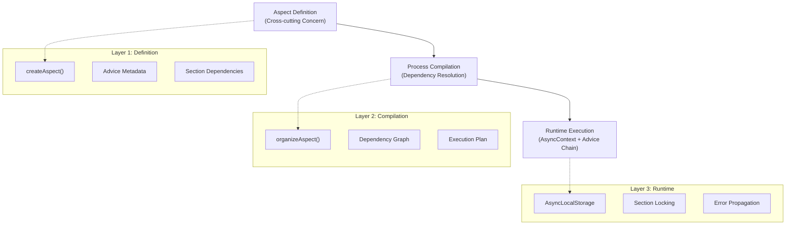
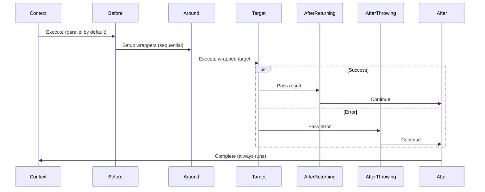
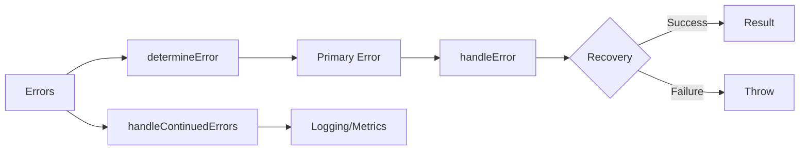

# Promise-AOP

**Latest version: v0.6.0**

A TypeScript-first AOP (Aspect-Oriented Programming) framework designed as a core infrastructure component for building robust asynchronous applications. Promise-AOP provides a type-safe, zero-dependency foundation for managing cross-cutting concerns with explicit context management and thread-safe execution.

**Note**: This is a core library intended for use as a building block in other frameworks and applications. The API prioritizes technical precision and extensibility over simplicity.

[한국어 문서 (Korean Documentation)](./docs/README-ko.md)

---

## Design Principles

Promise-AOP is built on the following technical foundations:

### 1. Type Safety First

- Full TypeScript support with generic type inference
- Context access restricted by declared sections at compile-time
- No runtime type coercion or dynamic property access

### 2. Explicit Context Management

- Section-based context system prevents concurrent access conflicts
- Thread-safe execution using Node.js `AsyncLocalStorage`
- Dependency graph resolution for advice ordering

### 3. Composable Architecture

- Aspects as first-class, reusable units
- Process compilation separates configuration from execution
- Advice chaining with configurable execution strategies

### 4. Zero Dependencies

- Built entirely on Node.js standard library
- No external runtime dependencies
- Minimal surface area for security and compatibility

---

## Architecture Overview

Promise-AOP implements a three-layer execution model:



### Execution Flow

The framework executes advice in a well-defined order with configurable error handling:



**Key Execution Properties:**

- `before` advice executes in parallel unless dependencies specified
- `around` advice wraps target with two composition points (target/result)
- Error handling uses specialized `Rejection` types for control flow
- Context access is protected by section-based locking mechanism

---

## Installation

```bash
# npm
npm install @h1ylabs/promise-aop

# yarn
yarn add @h1ylabs/promise-aop

# pnpm
pnpm add @h1ylabs/promise-aop
```

**Requirements**: Node.js 16+ (uses `AsyncLocalStorage`)

---

## Core Concepts

### Aspect

A modular unit encapsulating a cross-cutting concern with typed advice:

```typescript
type Aspect<Result, Context> = {
  readonly name: string;
  readonly before?: AdviceMetadata<Result, Context, "before">;
  readonly around?: AdviceMetadata<Result, Context, "around">;
  readonly afterReturning?: AdviceMetadata<Result, Context, "afterReturning">;
  readonly afterThrowing?: AdviceMetadata<Result, Context, "afterThrowing">;
  readonly after?: AdviceMetadata<Result, Context, "after">;
};
```

### Process

Compiled execution chain with resolved dependencies and error handling configuration:

```typescript
type Process<Result, Context> = (
  context: ContextAccessor<Context>,
  exit: ExecutionOuterContext,
  target: Target<Result>,
) => Promise<Result>;
```

### Context & Sections

Thread-safe shared state accessed through declared sections:

```typescript
// Context is split into sections for fine-grained access control
type AppContext = {
  logger: Logger;
  db: Database;
  cache: Cache;
};

// Advice declares which sections it needs
const aspect = createAspect<Data, AppContext>((createAdvice) => ({
  name: "example",
  before: createAdvice({
    use: ["logger", "db"], // Type-checked access
    advice: async ({ logger, db }) => {
      // Only logger and db are accessible
      // cache is not available (compile error if accessed)
    },
  }),
}));
```

---

## Quick Start

```typescript
import { createAspect, createProcess, runProcess } from "@h1ylabs/promise-aop";

// 1. Define context type
type AppContext = { logger: Console };

// 2. Create aspect
const LoggingAspect = createAspect<string, AppContext>((createAdvice) => ({
  name: "logging",
  before: createAdvice({
    use: ["logger"],
    advice: async ({ logger }) => logger.info("Start"),
  }),
  after: createAdvice({
    use: ["logger"],
    advice: async ({ logger }) => logger.info("Complete"),
  }),
}));

// 3. Compile process
const process = createProcess<string, AppContext>({
  aspects: [LoggingAspect],
});

// 4. Execute
const result = await runProcess({
  process,
  context: () => ({ logger: console }),
  target: async () => "Hello, AOP!",
});
```

---

## API Reference

### Core Functions

#### `createAspect<Result, Context>(factory)`

Creates an aspect with typed advice definitions.

**Parameters:**

- `factory`: `(createAdvice: AdviceHelper) => Aspect<Result, Context>`

**Returns:** `Aspect<Result, Context>`

**Type Parameters:**

- `Result`: Return type of target functions
- `Context`: Shared context object (section-based)

#### `createProcess<Result, Context>(config)`

Compiles aspects into an executable process with dependency resolution.

**Parameters:**

```typescript
{
  aspects: readonly Aspect<Result, Context>[];
  buildOptions?: BuildOptions;
  processOptions?: ProcessOptions<Result, Context>;
}
```

**Returns:** `Process<Result, Context>`

**Compilation Steps:**

1. Collect advice by type from all aspects
2. Resolve dependencies using topological sort
3. Detect circular dependencies and section conflicts
4. Generate execution plan based on `BuildOptions`

#### `runProcess<Result, Context>(props)`

Executes a process with target function and context.

**Parameters:**

```typescript
{
  process: Process<Result, Context>;
  target: Target<Result>;
  context: ContextGenerator<Context> | AsyncContext<Context>;
}
```

**Returns:** `Promise<Result>`

#### `runProcessWith<Result, Context>(props)`

Advanced execution with explicit AsyncContext instance for reuse.

**Parameters:**

```typescript
{
  process: Process<Result, Context>;
  target: Target<Result>;
  context: AsyncContext<Context>; // Pre-created instance
  contextGenerator: ContextGenerator<Context>;
}
```

**Use Case:** Optimize performance by reusing AsyncContext across multiple executions.

### Advice Types & Signatures

| Advice Type      | Signature                                                                       | Execution Timing        |
| ---------------- | ------------------------------------------------------------------------------- | ----------------------- |
| `before`         | `(context: Restricted<Context, Sections>) => Promise<void>`                     | Before target execution |
| `around`         | `(context: Restricted<Context, Sections>, hooks: AroundHooks) => Promise<void>` | Wraps target execution  |
| `afterReturning` | `(context: Restricted<Context, Sections>, result: Result) => Promise<void>`     | After successful return |
| `afterThrowing`  | `(context: Restricted<Context, Sections>, error: unknown) => Promise<void>`     | After error thrown      |
| `after`          | `(context: Restricted<Context, Sections>) => Promise<void>`                     | Always (finally block)  |

### BuildOptions

Controls execution strategy and error handling per advice type:

```typescript
type BuildOptions = {
  advice?: {
    [AdviceType in Advice]?: {
      execution?: "parallel" | "sequential";
      error?: {
        aggregation?: "unit" | "all"; // Stop on first or collect all
        runtime?: {
          afterThrow?: "halt" | "continue"; // Propagate or continue
        };
      };
    };
  };
};
```

**Default Configuration:**

| Advice Type      | Execution    | Aggregation | After Throw | Rationale                           |
| ---------------- | ------------ | ----------- | ----------- | ----------------------------------- |
| `before`         | `parallel`   | `unit`      | `halt`      | Fail fast on validation errors      |
| `around`         | `sequential` | `unit`      | `halt`      | Preserve wrapper order              |
| `afterReturning` | `parallel`   | `all`       | `continue`  | Best-effort cleanup                 |
| `afterThrowing`  | `parallel`   | `all`       | `continue`  | Collect all error handling failures |
| `after`          | `parallel`   | `all`       | `continue`  | Finally block semantics             |

### ProcessOptions

Centralized error handling with three extension points:

```typescript
type ProcessOptions<Result, Context> = {
  // Select primary error from multiple failures
  determineError?: (props: {
    context: ContextAccessor<Context>;
    exit: ExecutionOuterContext;
    errors: unknown[];
    info: ErrorInfo;
  }) => Promise<unknown>;

  // Implement recovery logic
  handleError?: (props: {
    currentTarget: Target<Result>;
    context: ContextAccessor<Context>;
    exit: ExecutionOuterContext;
    error: unknown;
  }) => Promise<Result>;

  // Handle continued errors (non-halting)
  handleContinuedErrors?: (props: {
    context: ContextAccessor<Context>;
    exit: ExecutionOuterContext;
    errors: readonly (readonly [unknown[], ErrorInfo])[];
  }) => Promise<void>;
};
```

**Error Flow:**



### Advanced Types

#### Context Types

```typescript
// Context generator (simple function)
type ContextGenerator<Context> = () => Context;

// Context accessor (read-only access)
type ContextAccessor<Context> = () => Context;

// Section-based restriction
type Restricted<Context, Sections> =
  Pick<Context, Sections[number]> & Readonly<...>;

// Sections declaration
type SectionsUsed<Context> = readonly (keyof Context)[];
```

#### Target & Wrapper Types

```typescript
// Async target function
type Target<Result> = () => Promise<Result>;

// Target wrapper (for around advice)
type TargetWrapper<Result> = (target: Target<Result>) => Target<Result>;

// Around advice resolver
type AroundAdviceResolver<Result> = (
  propagateChain: TargetWrapper<Result>,
  nextChain: TargetWrapper<Result>,
) => Target<Result>;
```

#### Error Types

Promise-AOP uses specialized `Rejection` types for fine-grained error control flow:

```typescript
// Base rejection type
class Rejection extends Error {
  constructor(
    public readonly errors: unknown[],
    public readonly info: ErrorInfo,
  ) {}
}

// Halting rejection (stops execution)
class HaltRejection extends Rejection {}

// Continuous rejection (collected, non-halting)
class ContinuousRejection extends Rejection {}

// Error context information
type ErrorInfo =
  | { occurredFrom: "target" }
  | { occurredFrom: "unknown" }
  | { occurredFrom: "advice"; advice: Advice };
```

**Rejection Type Usage:**

- **`Rejection`**: Base class thrown by advice when errors occur. Contains array of errors and context information about where the error originated.

- **`HaltRejection`**: Created when an error should stop execution immediately. Used by advice types with `afterThrow: "halt"` configuration. Triggers `handleError` in `ProcessOptions`.

- **`ContinuousRejection`**: Created when an error should be collected but not halt execution. Used by advice types with `afterThrow: "continue"` configuration. Collected and passed to `handleContinuedErrors`.

**Error Origin Tracking:**

- `occurredFrom: "target"`: Error thrown by the target function itself
- `occurredFrom: "advice"`: Error thrown during advice execution (includes which advice type)
- `occurredFrom: "unknown"`: Error from unexpected sources (framework internal)

---

## Advanced Implementation

### Internal Execution Model

Promise-AOP uses a multi-phase execution model with explicit error boundaries:

1. **Compilation Phase** (`createProcess`):
   - Aspects are organized by advice type
   - Dependency graphs are built using topological sort
   - Section conflicts are detected at compilation time
   - Execution strategies are frozen into the process

2. **Setup Phase** (`runProcess`):
   - AsyncContext is initialized with context generator
   - Context sections are locked based on advice declarations
   - Error handlers are attached to execution chain

3. **Execution Phase**:
   - `before` advice executes with configurable parallelism
   - `around` advice builds wrapper chains (target then result)
   - Target executes within composed wrappers
   - `afterReturning` or `afterThrowing` based on outcome
   - `after` always executes (finally semantics)

4. **Teardown Phase**:
   - Continuous rejections are collected
   - Halt rejection triggers error handlers
   - AsyncContext is cleaned up

### Around Advice Composition

The `around` advice provides two composition points for maximum flexibility:

```typescript
const aspect = createAspect<number, Context>((createAdvice) => ({
  name: "composition",
  around: createAdvice({
    use: ["logger"],
    advice: async ({ logger }, { attachToTarget, attachToResult }) => {
      // attachToTarget: wraps the original target function
      // Executes closest to the target
      attachToTarget((target) => async () => {
        logger.info("Target wrapper: before");
        const result = await target();
        logger.info("Target wrapper: after");
        return result + 1;
      });

      // attachToResult: wraps the entire execution chain
      // Executes at the outermost layer
      attachToResult((target) => async () => {
        logger.info("Result wrapper: before");
        const result = await target();
        logger.info("Result wrapper: after");
        return result * 2;
      });
    },
  }),
}));

// Execution order (LIFO):
// Result wrapper: before
//   Target wrapper: before
//     [original target]
//   Target wrapper: after
// Result wrapper: after
// Final: (originalResult + 1) * 2
```

**Composition Visualization:**


### Optimization Guidelines

1. **Process Reuse**: Create process once, reuse across executions

   ```typescript
   // Good
   const process = createProcess({ aspects });
   const execute = (target) => runProcess({ process, target, context });

   // Bad
   const execute = (target) =>
     runProcess({ process: createProcess({ aspects }), target, context });
   ```

2. **Section Granularity**: Use fine-grained sections for better parallelism

   ```typescript
   // Good: separate sections
   type Context = {
     readOnlyConfig: Config;
     logger: Logger;
     metrics: Metrics;
   };

   // Bad: coarse sections
   type Context = {
     services: { logger: Logger; metrics: Metrics; config: Config };
   };
   ```

3. **AsyncContext Reuse**: Use `runProcessWith` for high-frequency executions

   ```typescript
   class ServiceManager {
     private asyncContext = AsyncContext.create<Context>();

     execute<T>(target: Target<T>) {
       return runProcessWith({
         process: this.process,
         target,
         context: this.asyncContext, // Reused
         contextGenerator: () => this.buildContext(),
       });
     }
   }
   ```

### Extension Guide

Promise-AOP is designed to be extended for domain-specific frameworks:

#### Building a Framework

```typescript
// 1. Define domain-specific context
type DomainContext = {
  auth: AuthService;
  db: DatabaseConnection;
  logger: Logger;
};

// 2. Create reusable aspect library
export const AuthAspect = createAspect<any, DomainContext>((createAdvice) => ({
  name: "auth",
  before: createAdvice({
    use: ["auth"],
    advice: async ({ auth }) => {
      if (!auth.isAuthenticated()) {
        throw new UnauthorizedError();
      }
    },
  }),
}));

// 3. Provide high-level API
export class DomainService {
  private process = createProcess<any, DomainContext>({
    aspects: [AuthAspect, LoggingAspect, MetricsAspect],
  });

  async execute<T>(target: Target<T>): Promise<T> {
    return runProcess({
      process: this.process,
      target,
      context: () => this.buildContext(),
    });
  }
}
```

#### Custom Advice Types

While the five advice types cover most use cases, you can simulate custom timing:

```typescript
// Simulated "beforeValidation" using dependsOn
const ValidationAspect = createAspect(/* ... */);
const BeforeValidationAspect = createAspect((createAdvice) => ({
  name: "beforeValidation",
  before: createAdvice({
    dependsOn: ["validation"], // Runs before validation
    advice: async () => {
      /* ... */
    },
  }),
}));
```

#### Integration with Other Systems

```typescript
// Example: OpenTelemetry integration
const TracingAspect = createAspect<any, { tracer: Tracer }>((createAdvice) => ({
  name: "tracing",
  around: createAdvice({
    use: ["tracer"],
    advice: async ({ tracer }, { attachToTarget }) => {
      attachToTarget((target) => async () => {
        const span = tracer.startSpan("operation");
        try {
          return await target();
        } finally {
          span.end();
        }
      });
    },
  }),
}));
```

### Design Constraints & Trade-offs

1. **No Dynamic Aspect Composition**: Aspects must be known at process compilation time for performance and type safety

2. **Section-Based Locking**: Prevents data races but requires upfront section declaration

3. **AsyncLocalStorage Dependency**: Requires Node.js 16+, not suitable for browsers

4. **Synchronous Advice Not Supported**: All advice must return `Promise<void>` for consistent async handling

5. **Process Immutability**: Compiled processes are immutable for thread-safety and memoization

---

## Development

```bash
# Install dependencies
yarn install

# Run tests
yarn test

# Build the library
yarn build

# Type check
yarn check-types

# Lint
yarn lint
```

---

## License

MIT © [h1ylabs](https://github.com/h1ylabs)
