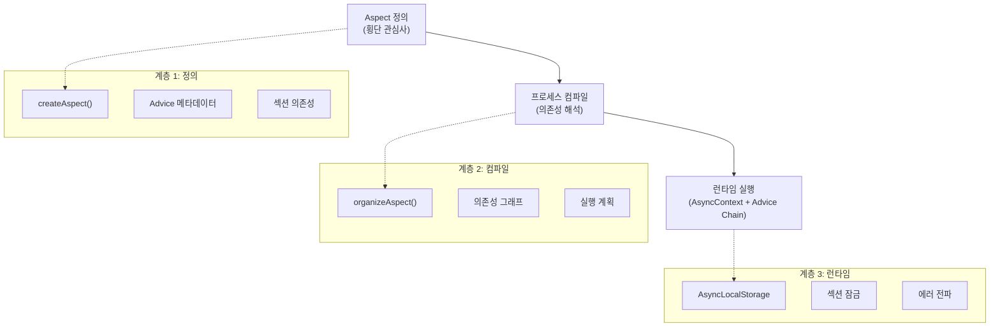
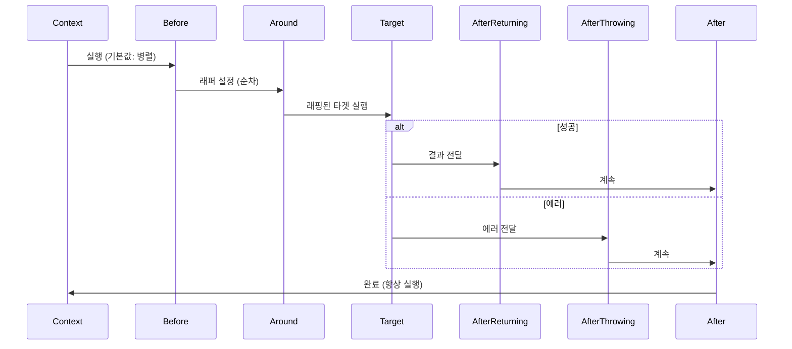
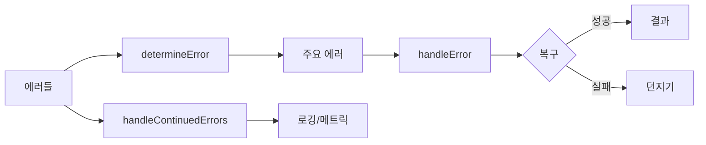
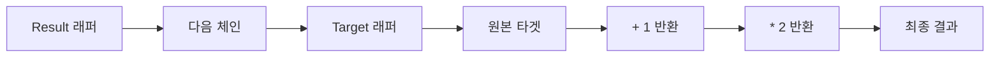

# Promise-AOP

**최신 버전: v0.6.0**

강력한 비동기 애플리케이션 구축을 위한 코어 인프라 컴포넌트로 설계된 TypeScript-first AOP(Aspect-Oriented Programming) 프레임워크입니다. Promise-AOP는 명시적 컨텍스트 관리와 스레드 안전 실행을 통해 횡단 관심사를 관리하기 위한 타입 안전하고 의존성 없는 기반을 제공합니다.

**참고**: 이 라이브러리는 다른 프레임워크와 애플리케이션의 빌딩 블록으로 사용하기 위한 코어 라이브러리입니다. API는 단순성보다 기술적 정밀성과 확장성을 우선시합니다.

[English Documentation](../README.md)

---

## 설계 원칙

Promise-AOP는 다음과 같은 기술적 기반 위에 구축되었습니다:

### 1. 타입 안전성 우선

- 제네릭 타입 추론을 통한 완전한 TypeScript 지원
- 컴파일 타임에 선언된 섹션으로 제한되는 컨텍스트 접근
- 런타임 타입 변환 또는 동적 속성 접근 없음

### 2. 명시적 컨텍스트 관리

- 섹션 기반 컨텍스트 시스템으로 동시 접근 충돌 방지
- Node.js `AsyncLocalStorage`를 사용한 스레드 안전 실행
- Advice 순서 지정을 위한 의존성 그래프 해석

### 3. 조합 가능한 아키텍처

- Aspect를 일급 재사용 가능 단위로 사용
- 프로세스 컴파일이 구성과 실행을 분리
- 구성 가능한 실행 전략을 가진 Advice 체이닝

### 4. 제로 의존성

- 전적으로 Node.js 표준 라이브러리 기반
- 외부 런타임 의존성 없음
- 보안과 호환성을 위한 최소 표면적

---

## 아키텍처 개요

Promise-AOP는 3계층 실행 모델을 구현합니다:



### 실행 흐름

프레임워크는 구성 가능한 에러 처리와 함께 잘 정의된 순서로 advice를 실행합니다:



**주요 실행 속성:**

- `before` advice는 의존성이 지정되지 않으면 병렬 실행
- `around` advice는 두 개의 조합 지점(target/result)으로 타겟을 래핑
- 에러 처리는 제어 흐름을 위해 특수한 `Rejection` 타입 사용
- 컨텍스트 접근은 섹션 기반 잠금 메커니즘으로 보호됨

---

## 설치

```bash
# npm
npm install @h1ylabs/promise-aop

# yarn
yarn add @h1ylabs/promise-aop

# pnpm
pnpm add @h1ylabs/promise-aop
```

**요구사항**: Node.js 16+ (`AsyncLocalStorage` 사용)

---

## 핵심 개념

### Aspect

타입이 지정된 advice로 횡단 관심사를 캡슐화하는 모듈 단위:

```typescript
type Aspect<Result, Context> = {
  readonly name: string;
  readonly before?: AdviceMetadata<Result, Context, "before">;
  readonly around?: AdviceMetadata<Result, Context, "around">;
  readonly afterReturning?: AdviceMetadata<Result, Context, "afterReturning">;
  readonly afterThrowing?: AdviceMetadata<Result, Context, "afterThrowing">;
  readonly after?: AdviceMetadata<Result, Context, "after">;
};
```

### Process

의존성이 해결되고 에러 처리가 구성된 컴파일된 실행 체인:

```typescript
type Process<Result, Context> = (
  context: ContextAccessor<Context>,
  exit: ExecutionOuterContext,
  target: Target<Result>,
) => Promise<Result>;
```

### Context & Sections

선언된 섹션을 통해 접근되는 스레드 안전 공유 상태:

```typescript
// 컨텍스트는 세분화된 접근 제어를 위해 섹션으로 분할됨
type AppContext = {
  logger: Logger;
  db: Database;
  cache: Cache;
};

// Advice는 필요한 섹션을 선언함
const aspect = createAspect<Data, AppContext>((createAdvice) => ({
  name: "example",
  before: createAdvice({
    use: ["logger", "db"], // 타입 검사된 접근
    advice: async ({ logger, db }) => {
      // logger와 db만 접근 가능
      // cache는 사용 불가 (접근 시 컴파일 에러)
    },
  }),
}));
```

---

## 빠른 시작

```typescript
import { createAspect, createProcess, runProcess } from "@h1ylabs/promise-aop";

// 1. 컨텍스트 타입 정의
type AppContext = { logger: Console };

// 2. Aspect 생성
const LoggingAspect = createAspect<string, AppContext>((createAdvice) => ({
  name: "logging",
  before: createAdvice({
    use: ["logger"],
    advice: async ({ logger }) => logger.info("시작"),
  }),
  after: createAdvice({
    use: ["logger"],
    advice: async ({ logger }) => logger.info("완료"),
  }),
}));

// 3. 프로세스 컴파일
const process = createProcess<string, AppContext>({
  aspects: [LoggingAspect],
});

// 4. 실행
const result = await runProcess({
  process,
  context: () => ({ logger: console }),
  target: async () => "안녕, AOP!",
});
```

---

## API 레퍼런스

### 핵심 함수

#### `createAspect<Result, Context>(factory)`

타입이 지정된 advice 정의로 aspect를 생성합니다.

**매개변수:**

- `factory`: `(createAdvice: AdviceHelper) => Aspect<Result, Context>`

**반환값:** `Aspect<Result, Context>`

**타입 매개변수:**

- `Result`: 타겟 함수의 반환 타입
- `Context`: 공유 컨텍스트 객체 (섹션 기반)

#### `createProcess<Result, Context>(config)`

의존성 해석과 함께 aspect들을 실행 가능한 프로세스로 컴파일합니다.

**매개변수:**

```typescript
{
  aspects: readonly Aspect<Result, Context>[];
  buildOptions?: BuildOptions;
  processOptions?: ProcessOptions<Result, Context>;
}
```

**반환값:** `Process<Result, Context>`

**컴파일 단계:**

1. 모든 aspect에서 타입별로 advice 수집
2. 위상 정렬을 사용하여 의존성 해석
3. 순환 의존성 및 섹션 충돌 감지
4. `BuildOptions`를 기반으로 실행 계획 생성

#### `runProcess<Result, Context>(props)`

타겟 함수와 컨텍스트로 프로세스를 실행합니다.

**매개변수:**

```typescript
{
  process: Process<Result, Context>;
  target: Target<Result>;
  context: ContextGenerator<Context> | AsyncContext<Context>;
}
```

**반환값:** `Promise<Result>`

#### `runProcessWith<Result, Context>(props)`

재사용을 위해 명시적 AsyncContext 인스턴스를 사용한 고급 실행.

**매개변수:**

```typescript
{
  process: Process<Result, Context>;
  target: Target<Result>;
  context: AsyncContext<Context>; // 미리 생성된 인스턴스
  contextGenerator: ContextGenerator<Context>;
}
```

**사용 사례:** 여러 실행에서 AsyncContext를 재사용하여 성능 최적화.

### Advice 타입 & 시그니처

| Advice 타입      | 시그니처                                                                        | 실행 시점           |
| ---------------- | ------------------------------------------------------------------------------- | ------------------- |
| `before`         | `(context: Restricted<Context, Sections>) => Promise<void>`                     | 타겟 실행 전        |
| `around`         | `(context: Restricted<Context, Sections>, hooks: AroundHooks) => Promise<void>` | 타겟 실행 래핑      |
| `afterReturning` | `(context: Restricted<Context, Sections>, result: Result) => Promise<void>`     | 성공적인 반환 후    |
| `afterThrowing`  | `(context: Restricted<Context, Sections>, error: unknown) => Promise<void>`     | 에러 발생 후        |
| `after`          | `(context: Restricted<Context, Sections>) => Promise<void>`                     | 항상 (finally 블록) |

### BuildOptions

advice 타입별 실행 전략 및 에러 처리 제어:

```typescript
type BuildOptions = {
  advice?: {
    [AdviceType in Advice]?: {
      execution?: "parallel" | "sequential";
      error?: {
        aggregation?: "unit" | "all"; // 첫 번째에서 중단 또는 모두 수집
        runtime?: {
          afterThrow?: "halt" | "continue"; // 전파 또는 계속
        };
      };
    };
  };
};
```

**기본 구성:**

| Advice 타입      | 실행         | 집계   | 에러 후    | 근거                      |
| ---------------- | ------------ | ------ | ---------- | ------------------------- |
| `before`         | `parallel`   | `unit` | `halt`     | 검증 에러에서 빠르게 실패 |
| `around`         | `sequential` | `unit` | `halt`     | 래퍼 순서 보존            |
| `afterReturning` | `parallel`   | `all`  | `continue` | 최선 노력 정리            |
| `afterThrowing`  | `parallel`   | `all`  | `continue` | 모든 에러 처리 실패 수집  |
| `after`          | `parallel`   | `all`  | `continue` | Finally 블록 의미         |

### ProcessOptions

세 가지 확장 지점을 가진 중앙화된 에러 처리:

```typescript
type ProcessOptions<Result, Context> = {
  // 여러 실패에서 주요 에러 선택
  determineError?: (props: {
    context: ContextAccessor<Context>;
    exit: ExecutionOuterContext;
    errors: unknown[];
    info: ErrorInfo;
  }) => Promise<unknown>;

  // 복구 로직 구현
  handleError?: (props: {
    currentTarget: Target<Result>;
    context: ContextAccessor<Context>;
    exit: ExecutionOuterContext;
    error: unknown;
  }) => Promise<Result>;

  // 계속된 에러 처리 (중단되지 않음)
  handleContinuedErrors?: (props: {
    context: ContextAccessor<Context>;
    exit: ExecutionOuterContext;
    errors: readonly (readonly [unknown[], ErrorInfo])[];
  }) => Promise<void>;
};
```

**에러 흐름:**



### 고급 타입

#### 컨텍스트 타입

```typescript
// 컨텍스트 생성기 (간단한 함수)
type ContextGenerator<Context> = () => Context;

// 컨텍스트 접근자 (읽기 전용 접근)
type ContextAccessor<Context> = () => Context;

// 섹션 기반 제한
type Restricted<Context, Sections> =
  Pick<Context, Sections[number]> & Readonly<...>;

// 섹션 선언
type SectionsUsed<Context> = readonly (keyof Context)[];
```

#### 타겟 & 래퍼 타입

```typescript
// 비동기 타겟 함수
type Target<Result> = () => Promise<Result>;

// 타겟 래퍼 (around advice용)
type TargetWrapper<Result> = (target: Target<Result>) => Target<Result>;

// Around advice 리졸버
type AroundAdviceResolver<Result> = (
  propagateChain: TargetWrapper<Result>,
  nextChain: TargetWrapper<Result>,
) => Target<Result>;
```

#### 에러 타입

Promise-AOP는 세밀한 에러 제어 흐름을 위해 특수한 `Rejection` 타입을 사용합니다:

```typescript
// 기본 rejection 타입
class Rejection extends Error {
  constructor(
    public readonly errors: unknown[],
    public readonly info: ErrorInfo,
  ) {}
}

// 중단 rejection (실행 중단)
class HaltRejection extends Rejection {}

// 계속 rejection (수집됨, 중단되지 않음)
class ContinuousRejection extends Rejection {}

// 에러 컨텍스트 정보
type ErrorInfo =
  | { occurredFrom: "target" }
  | { occurredFrom: "unknown" }
  | { occurredFrom: "advice"; advice: Advice };
```

**Rejection 타입 사용법:**

- **`Rejection`**: Advice에서 에러가 발생할 때 던져지는 기본 클래스. 에러 배열과 에러가 발생한 위치에 대한 컨텍스트 정보를 포함합니다.

- **`HaltRejection`**: 실행을 즉시 중단해야 하는 에러가 발생했을 때 생성됩니다. `afterThrow: "halt"` 구성을 가진 advice 타입에서 사용됩니다. `ProcessOptions`의 `handleError`를 트리거합니다.

- **`ContinuousRejection`**: 수집되어야 하지만 실행을 중단하지 않는 에러가 발생했을 때 생성됩니다. `afterThrow: "continue"` 구성을 가진 advice 타입에서 사용됩니다. 수집되어 `handleContinuedErrors`로 전달됩니다.

**에러 발생 위치 추적:**

- `occurredFrom: "target"`: 타겟 함수 자체에서 발생한 에러
- `occurredFrom: "advice"`: Advice 실행 중 발생한 에러 (어떤 advice 타입인지 포함)
- `occurredFrom: "unknown"`: 예상치 못한 소스에서 발생한 에러 (프레임워크 내부)

---

## 고급 구현

### 내부 실행 모델

Promise-AOP는 명시적 에러 경계를 가진 다단계 실행 모델을 사용합니다:

1. **컴파일 단계** (`createProcess`):
   - Aspect들이 advice 타입별로 조직됨
   - 위상 정렬을 사용하여 의존성 그래프 구축
   - 컴파일 시점에 섹션 충돌 감지
   - 실행 전략이 프로세스에 고정됨

2. **설정 단계** (`runProcess`):
   - 컨텍스트 생성기로 AsyncContext 초기화
   - Advice 선언을 기반으로 컨텍스트 섹션 잠금
   - 실행 체인에 에러 핸들러 부착

3. **실행 단계**:
   - `before` advice가 구성 가능한 병렬성으로 실행
   - `around` advice가 래퍼 체인 구축 (먼저 target, 그 다음 result)
   - 타겟이 조합된 래퍼 내에서 실행
   - 결과에 따라 `afterReturning` 또는 `afterThrowing`
   - `after`는 항상 실행 (finally 의미)

4. **정리 단계**:
   - 계속 rejection들이 수집됨
   - 중단 rejection이 에러 핸들러 트리거
   - AsyncContext 정리

### Around Advice 조합

`around` advice는 최대 유연성을 위해 두 개의 조합 지점을 제공합니다:

```typescript
const aspect = createAspect<number, Context>((createAdvice) => ({
  name: "composition",
  around: createAdvice({
    use: ["logger"],
    advice: async ({ logger }, { attachToTarget, attachToResult }) => {
      // attachToTarget: 원본 타겟 함수를 래핑
      // 타겟에 가장 가깝게 실행됨
      attachToTarget((target) => async () => {
        logger.info("Target 래퍼: 전");
        const result = await target();
        logger.info("Target 래퍼: 후");
        return result + 1;
      });

      // attachToResult: 전체 실행 체인을 래핑
      // 가장 바깥 레이어에서 실행됨
      attachToResult((target) => async () => {
        logger.info("Result 래퍼: 전");
        const result = await target();
        logger.info("Result 래퍼: 후");
        return result * 2;
      });
    },
  }),
}));

// 실행 순서 (LIFO):
// Result 래퍼: 전
//   Target 래퍼: 전
//     [원본 타겟]
//   Target 래퍼: 후
// Result 래퍼: 후
// 최종: (originalResult + 1) * 2
```

**조합 시각화:**



### 최적화 가이드라인

1. **프로세스 재사용**: 프로세스를 한 번 생성하고 실행에서 재사용

   ```typescript
   // 좋음
   const process = createProcess({ aspects });
   const execute = (target) => runProcess({ process, target, context });

   // 나쁨
   const execute = (target) =>
     runProcess({ process: createProcess({ aspects }), target, context });
   ```

2. **섹션 세분화**: 더 나은 병렬성을 위해 세분화된 섹션 사용

   ```typescript
   // 좋음: 별도 섹션
   type Context = {
     readOnlyConfig: Config;
     logger: Logger;
     metrics: Metrics;
   };

   // 나쁨: 거친 섹션
   type Context = {
     services: { logger: Logger; metrics: Metrics; config: Config };
   };
   ```

3. **AsyncContext 재사용**: 고빈도 실행을 위해 `runProcessWith` 사용

   ```typescript
   class ServiceManager {
     private asyncContext = AsyncContext.create<Context>();

     execute<T>(target: Target<T>) {
       return runProcessWith({
         process: this.process,
         target,
         context: this.asyncContext, // 재사용됨
         contextGenerator: () => this.buildContext(),
       });
     }
   }
   ```

### 확장 가이드

Promise-AOP는 도메인별 프레임워크로 확장되도록 설계되었습니다:

#### 프레임워크 구축

```typescript
// 1. 도메인별 컨텍스트 정의
type DomainContext = {
  auth: AuthService;
  db: DatabaseConnection;
  logger: Logger;
};

// 2. 재사용 가능한 aspect 라이브러리 생성
export const AuthAspect = createAspect<any, DomainContext>((createAdvice) => ({
  name: "auth",
  before: createAdvice({
    use: ["auth"],
    advice: async ({ auth }) => {
      if (!auth.isAuthenticated()) {
        throw new UnauthorizedError();
      }
    },
  }),
}));

// 3. 높은 수준의 API 제공
export class DomainService {
  private process = createProcess<any, DomainContext>({
    aspects: [AuthAspect, LoggingAspect, MetricsAspect],
  });

  async execute<T>(target: Target<T>): Promise<T> {
    return runProcess({
      process: this.process,
      target,
      context: () => this.buildContext(),
    });
  }
}
```

#### 사용자 정의 Advice 타입

다섯 가지 advice 타입이 대부분의 사용 사례를 다루지만, 사용자 정의 타이밍을 시뮬레이션할 수 있습니다:

```typescript
// dependsOn을 사용한 "beforeValidation" 시뮬레이션
const ValidationAspect = createAspect(/* ... */);
const BeforeValidationAspect = createAspect((createAdvice) => ({
  name: "beforeValidation",
  before: createAdvice({
    dependsOn: ["validation"], // 검증 전에 실행됨
    advice: async () => {
      /* ... */
    },
  }),
}));
```

#### 다른 시스템과의 통합

```typescript
// 예시: OpenTelemetry 통합
const TracingAspect = createAspect<any, { tracer: Tracer }>((createAdvice) => ({
  name: "tracing",
  around: createAdvice({
    use: ["tracer"],
    advice: async ({ tracer }, { attachToTarget }) => {
      attachToTarget((target) => async () => {
        const span = tracer.startSpan("operation");
        try {
          return await target();
        } finally {
          span.end();
        }
      });
    },
  }),
}));
```

### 설계 제약 사항 & 트레이드오프

1. **동적 Aspect 조합 불가**: 성능과 타입 안전성을 위해 프로세스 컴파일 시점에 Aspect가 알려져야 함

2. **섹션 기반 잠금**: 데이터 경쟁을 방지하지만 사전 섹션 선언이 필요함

3. **AsyncLocalStorage 의존성**: Node.js 16+ 필요, 브라우저에는 적합하지 않음

4. **동기 Advice 미지원**: 일관된 비동기 처리를 위해 모든 advice가 `Promise<void>`를 반환해야 함

5. **프로세스 불변성**: 컴파일된 프로세스는 스레드 안전성과 메모이제이션을 위해 불변임

---

## 개발

```bash
# 의존성 설치
yarn install

# 테스트 실행
yarn test

# 라이브러리 빌드
yarn build

# 타입 검사
yarn check-types

# 린트
yarn lint
```

---

## 라이선스

MIT © [h1ylabs](https://github.com/h1ylabs)
